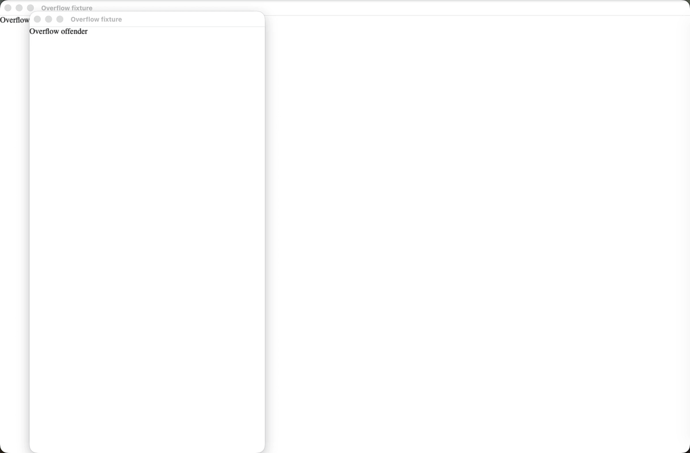

# Viewport Sentinel

[](https://github.com/maksimryzhov614/viewport-sentinel/actions/workflows/ci.yml)
[](https://github.com/maksimryzhov614/viewport-sentinel/actions/workflows/release.yml)
[](LICENSE)

Catch responsive overflow, blocked controls, browser-selected image failures,
and page errors in real Chromium before they reach production.

Viewport Sentinel is a focused CLI and GitHub Action. It audits an explicit
page × viewport matrix and produces deterministic JSON and SARIF reports.
It is not a crawler, Lighthouse replacement, or pixel-diff service.

## Verified demo

[](https://github.com/maksimryzhov614/viewport-sentinel/actions/runs/30747735855)

The seeded public workflow reports 6 findings across all 10 configured
page × viewport combinations. It writes the job summary, JSON, SARIF, and the
downloadable artifact before intentionally propagating the audit failure.

## Quick start

Viewport Sentinel supports Node.js 22, 24, and 26. Install it in the project
whose app you want to audit, then install the matching Chromium binary:

```sh
npm install --save-dev viewport-sentinel
npx playwright install chromium
```

Create `viewport-sentinel.config.json`. This complete example audits one page
at two viewport sizes and writes both report formats:

<!-- quick-start-config -->

```json
{
  "$schema": "./node_modules/viewport-sentinel/config.schema.json",
  "version": 1,
  "baseUrl": "http://127.0.0.1:4173",
  "pages": [{ "name": "home", "path": "/clean" }],
  "viewports": [
    {
      "name": "mobile-320",
      "width": 320,
      "height": 844,
      "deviceScaleFactor": 1
    },
    {
      "name": "desktop-1440",
      "width": 1440,
      "height": 900,
      "deviceScaleFactor": 1
    }
  ],
  "timeoutMs": 10000,
  "output": {
    "dir": "artifacts/viewport-sentinel",
    "formats": ["json", "sarif"]
  }
}
```

Start your app separately and wait until the configured URL is ready. Then run
the audit from the directory containing the config:

<!-- quick-start-command -->

```sh
npx viewport-sentinel --config viewport-sentinel.config.json
```

The command exits `0` when no findings are present, `1` when the audit
completed and found one or more issues (including a `VSRUN001` readiness
finding), and `2` for invalid configuration, browser launch, internal, or
report-writing failures. Exit `2` preserves partial reports when possible. The
example writes:

- `artifacts/viewport-sentinel/results.json`
- `artifacts/viewport-sentinel/results.sarif`

Use `--output <dir>` to override the configured directory. Use `--github` only
inside GitHub Actions to emit annotations and a step summary.

## GitHub Action

The calling workflow owns application startup and readiness. This example
builds the application, starts it, waits for it, and then runs Viewport
Sentinel. Reports are uploaded by the Action before its final exit status is
propagated.

```yaml
name: Responsive audit
on:
  pull_request:

permissions:
  contents: read

jobs:
  viewport-sentinel:
    runs-on: ubuntu-latest
    steps:
      - uses: actions/checkout@v6
      - uses: actions/setup-node@v6
        with:
          node-version: 24
      - run: npm ci
      - run: npm run build
      - name: Start app and wait for readiness
        run: |
          npm run start:test > /tmp/app.log 2>&1 &
          for attempt in {1..30}; do
            curl --fail --silent http://127.0.0.1:4173/health >/dev/null && exit 0
            sleep 1
          done
          cat /tmp/app.log
          exit 1
      - uses: maksimryzhov614/viewport-sentinel@v0.1.1
        with:
          config: viewport-sentinel.config.json
          output: artifacts/viewport-sentinel
```

The Action exposes `finding-count`, `report-json`, and `report-sarif` outputs.
Its composite runtime uses a separate final step so annotations, the job
summary, and report artifact are written before an audit exit of `1` or `2`.

## Verified release-candidate output

These excerpts were copied from reports generated by `0.1.1` against the
repository's seeded fixture matrix:

```text
Viewport Sentinel: 6 findings (10/10 combinations completed)
  VS001 overflow/mobile-320 html: Document is 160px wider than the viewport
  VS002 overlap/mobile-320 #checkout: Fixed/sticky element #mobile-cover covers actionable #checkout
  VS003 picture/mobile-320 #product-image: Browser-selected image did not load and decode
  VS003 picture/desktop-1440 #product-image: Browser-selected image did not load and decode
  VS004 console/mobile-320 document: viewport-sentinel fixture error
  VS004 console/desktop-1440 document: viewport-sentinel fixture error
```

```json
"tool": {
  "name": "viewport-sentinel",
  "version": "0.1.1"
},
"totals": {
  "findingCount": 6,
  "omittedByCombination": [],
  "omittedFindingCount": 0,
  "suppressedConsoleCount": 0
}
```

## Scope and limitations

Viewport Sentinel launches local Playwright Chromium and runs the configured
matrix serially, one fresh browser context per page and viewport combination.
It checks only the initial scroll position and does not interact with pages.
It has no crawler, Lighthouse audit, pixel comparison, Axe/accessibility
engine, authentication flow, custom-JavaScript hook, database, telemetry,
hosted service, or non-Chromium browser support.

Rule thresholds, visibility rules, caps, lazy-image behavior, console ignores,
privacy handling, and shadow-DOM exclusions are specified in
[Rule reference](docs/rules.md). The execution and reporting boundaries are in
[Architecture](docs/architecture.md).

## Project policies

See [CONTRIBUTING.md](CONTRIBUTING.md) for the TDD and determinism workflow,
[SECURITY.md](SECURITY.md) for private vulnerability reporting, and
[CHANGELOG.md](CHANGELOG.md) for the implemented `0.1.1` scope.

Released under the [MIT License](LICENSE).
